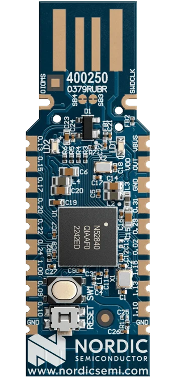
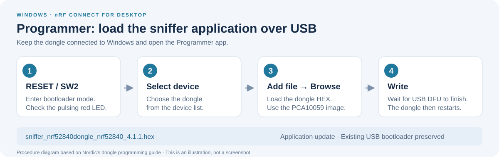

# Setup

[Back to README](../README.md)

The verified CLI workflow uses WSL for USB DFU programming and Windows for live
capture. You can also [program from Windows with Programmer](#alternative-program-from-windows-with-programmer)
and continue with [Windows Wireshark configuration](#5-configure-windows-wireshark).
If the dongle already runs Nordic's sniffer firmware, skip the firmware
programming steps and configure Windows Wireshark.

## Prerequisites

- A Nordic nRF52840 Dongle, **PCA10059**, with its existing USB DFU bootloader.
- For the WSL CLI route: Windows with [WSL 2 and Ubuntu installed](https://learn.microsoft.com/windows/wsl/install).
- For the WSL CLI route: an x86_64 Ubuntu environment and administrator access for sharing USB devices with usbipd-win.
- For the Windows programming route: [nRF Connect for Desktop](https://www.nordicsemi.com/Products/Development-tools/nRF-Connect-for-Desktop) with its Programmer app.
- Windows Wireshark and Windows nRF Util for the capture steps.

In Ubuntu, install the tools used by this guide if they are missing:

```bash
sudo apt update
sudo apt install curl usbutils
```

## 1. Install tools in WSL

Install the Linux x86_64 nRF Util executable:

```bash
mkdir -p ~/.local/bin
curl --fail --location \
  https://files.nordicsemi.com/artifactory/swtools/external/nrfutil/executables/x86_64-unknown-linux-gnu/nrfutil \
  --output ~/.local/bin/nrfutil
chmod +x ~/.local/bin/nrfutil
```

Add the executable directory to the current shell's search path:

```bash
export PATH="$HOME/.local/bin:$PATH"
```

To keep this setting in future Bash sessions, add it once to `~/.bashrc`:

```bash
echo 'export PATH="$HOME/.local/bin:$PATH"' >> ~/.bashrc
```

Check the executable and install the required commands:

```bash
command -v nrfutil
nrfutil --version
nrfutil install device ble-sniffer
nrfutil list
```

`nrfutil search` lists commands available to install. `nrfutil list` lists installed
commands. `nrfutil device list` lists connected supported devices.

Installing `ble-sniffer` downloads the host tool and firmware files. Programming
the dongle is a separate operation. The ready-made DFU package does not require
`nrf5sdk-tools` or an application SDK.

## 2. Attach the USB device to WSL

Install [usbipd-win](https://learn.microsoft.com/windows/wsl/connect-usb) on Windows.
In Windows PowerShell, find the dongle's current bus ID:

```powershell
usbipd list
```

If the device has not been shared, run the first command from an administrator
PowerShell terminal. Attach it using its actual bus ID:

```powershell
usbipd bind --busid <BUSID>
usbipd attach --wsl --busid <BUSID>
```

Check from WSL:

```bash
lsusb
ls -l /dev/ttyACM*
nrfutil device list
```

If serial access reports **Permission denied**, check the port's group with
`ls -l /dev/ttyACM*`. On Ubuntu, grant your user access to the `dialout` group:

```bash
sudo usermod -aG dialout "$USER"
newgrp dialout
```

`newgrp` opens a shell with the updated group membership. Retry the serial
command in that shell; reopening the login session is another option.

The bus ID and serial port can change when the USB device re-enumerates. Recheck
the listing after entering bootloader mode and reattach that device if needed.

## 3. Inspect the dongle DFU package

For the verified firmware version, the PCA10059 package is:

```text
~/.nrfutil/share/nrfutil-ble-sniffer/firmware/sniffer_nrf52840dongle_nrf52840_4.1.1.zip
```

If `NRFUTIL_HOME` is set, use its directory instead of `~/.nrfutil`. Check the
firmware files installed by your command version:

```bash
ls ~/.nrfutil/share/nrfutil-ble-sniffer/firmware/*dongle*.zip
```

The inspected ZIP's manifest contains an **application** update only. Its SHA-256
was verified as:

```text
a5ec3b26bfe1d5db7bf77c4fb0d4470924778ccf440ea846965b8a2bcb719048
```

Use the PCA10059 dongle ZIP through USB DFU to preserve the existing bootloader.

## 4. Program through the existing USB bootloader



*Nordic nRF52840 Dongle (PCA10059), with USB contacts at the top. RESET / SW2 is
the side-facing switch below the round SW1 user button. Press RESET toward the
USB connector. Photo: [Nordic Semiconductor](https://www.nordicsemi.com/Products/Development-hardware/nrf52840-dongle).
See Nordic's [RESET instructions](https://academy.nordicsemi.com/flash-instructions-for-nrf52840-dongle/)
for the press direction.*

1. Press the side-facing RESET button, SW2, at the end opposite the USB connector.
2. Check for the red LED fade/pulse pattern. The top-facing SW1 user button is different.
3. Recheck `usbipd list` and attach the bootloader device to WSL if it re-enumerated.
4. Verify Nordic DFU mode:

```bash
nrfutil device list --traits nordicDfu
```

The verified bootloader identified itself as **Open DFU Bootloader**, PCA10059,
with USB ID `1915:521f`. Replace the serial placeholder with the bootloader's
actual serial number:

```bash
nrfutil device program \
  --serial-number <DFU_SERIAL_NUMBER> \
  --traits nordicDfu \
  --firmware ~/.nrfutil/share/nrfutil-ble-sniffer/firmware/sniffer_nrf52840dongle_nrf52840_4.1.1.zip
```

This replaces the application. Erase, recovery, and bootloader programming are
outside this USB DFU workflow. A missing J-Link library warning does not prevent
USB DFU operations.

After programming, the verified application appeared as **nRF Sniffer for
Bluetooth LE**, USB ID `1915:522a`.

[Nordic firmware programming guide](https://docs.nordicsemi.com/r/bundle/nrfutil/page/nrfutil-ble-sniffer/guides/requirements.html/programming-sniffer-firmware-using-nrfutil-device)

### Alternative: program from Windows with Programmer

This route uses the existing USB DFU bootloader directly from Windows. WSL and
the Linux nRF Util installation are not required for this programming route.
The Windows capture plugin is still configured in the next section.



*Procedure diagram, not a screenshot. The labels follow Nordic's Programmer
workflow for the nRF52840 Dongle.*

1. Download [Nordic's original sniffer 4.1.1 ZIP](https://nsscprodmedia.blob.core.windows.net/prod/software-and-other-downloads/desktop-software/nrf-sniffer/sw/nrf_sniffer_for_bluetooth_le_4.1.1.zip)
   and extract it with Windows File Explorer. Retain the included `LICENSE.txt`.
2. Find `hex/sniffer_nrf52840dongle_nrf52840_4.1.1.hex` in the extracted package.
   This is the PCA10059 image; the `nrf52840dk` image is for a different board.
3. Stop any capture using the dongle. If it is attached to WSL, use `usbipd list`
   and `usbipd detach --busid <BUSID>` from Windows PowerShell to return it to Windows.
4. Open **nRF Connect for Desktop** and launch **Programmer**; install the app
   from the Desktop launcher if it is missing.
5. Press **RESET / SW2** and check that the red LED pulses. If the bootloader
   re-enumerates, make sure that device remains available to Windows.
6. Click **Select device** and choose the dongle's bootloader device.
7. Click **Add file > Browse** and select the dongle HEX file.
8. Click **Write** and wait for programming to finish. The dongle restarts and
   may disappear from Programmer once it leaves bootloader mode; this is expected.

Use the dongle image and the USB DFU **Write** operation to update the application
while preserving the existing bootloader. This Windows method was also verified
on the PCA10059 with firmware 4.1.1.

[Nordic Programmer instructions for the dongle](https://docs.nordicsemi.com/r/bundle/nrf-connect-for-desktop/page/app/pc-nrfconnect-programmer/programming_nrf52840_dongle.html)

## 5. Configure Windows Wireshark

Install [Wireshark for Windows](https://www.wireshark.org/download.html) and
[Windows nRF Util](https://docs.nordicsemi.com/r/bundle/nrfutil/page/guides/installing.html/installing-nrf-util-from-the-web-default).
The Windows installation is separate from the Linux executable used in WSL.

If the sniffer is attached to WSL, return it to Windows:

```powershell
usbipd list
usbipd detach --busid <BUSID>
```

Run in **Windows PowerShell**:

```powershell
nrfutil --version
nrfutil install device ble-sniffer
nrfutil ble-sniffer bootstrap --extcap-dir "$env:APPDATA\Wireshark\extcap"
nrfutil device list
& "$env:ProgramFiles\Wireshark\tshark.exe" -D
```

The bootstrap installs Nordic's official capture shim and its configuration in
Wireshark's personal extcap directory. The verified interface was:

```text
COM28 (nRF Sniffer for Bluetooth LE COM28)
```

Restart Wireshark after installing the plugin and continue with the
[usage guide](USAGE.md). Only one operating system can own the USB device at a time.

[Nordic Wireshark plugin installation guide](https://docs.nordicsemi.com/r/bundle/nrfutil/page/guides/installing_wireshark.html/installing-nrf-util-plugins)
