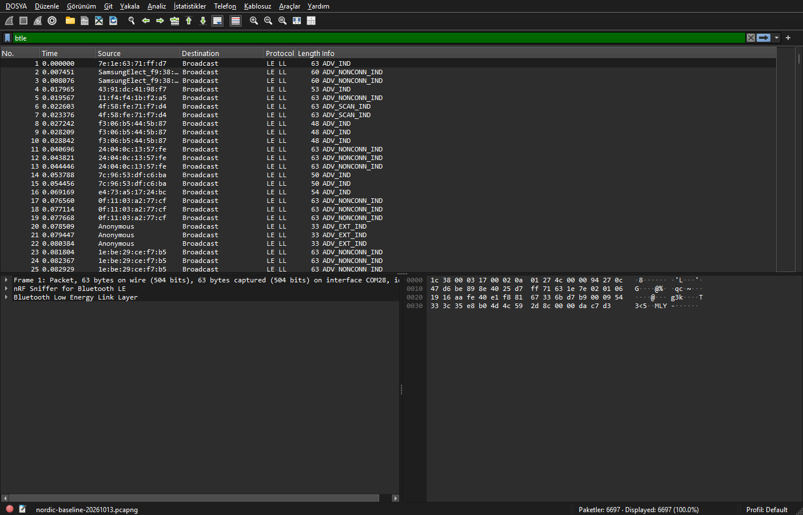

# Capture and filter BLE packets

[Back to README](../README.md)

## Start a live capture

1. Keep the sniffer connected to Windows; detach it from WSL if necessary.
2. Open Wireshark and select the **Default** profile.
3. Double-click **nRF Sniffer for Bluetooth LE COM28**, replacing COM28 with your current port.
4. Enable **View > Interface Toolbars > nRF Sniffer for Bluetooth LE** if the toolbar is hidden.
5. Initially select **All advertising devices** in the Nordic device list.
6. Enter `btle` in the display filter bar and press **Enter**.
7. Stop with the red capture stop button and save the capture as PCAPNG.



*The screenshot shows a saved capture from the verified setup. The green `btle`
bar is the display filter; Source and Destination are columns in the packet list.
The lower panes show the selected packet's protocol details and bytes.*

To follow one advertiser, select it in Nordic's device list. To follow a new
connection, select the peripheral before the connection starts and leave
**Only advertising packets** disabled in the interface options. Display filters
control the packet list; Nordic's device selection controls what the sniffer follows.

[Nordic user guide](https://docs.nordicsemi.com/r/bundle/nrfutil/page/nrfutil-ble-sniffer/guides/running_sniffer.html),
[Nordic device list](https://docs.nordicsemi.com/r/bundle/nrfutil/page/nrfutil-ble-sniffer/guides/sniffer_usage.html/device-list)

## Standard display filters

Enter these expressions in the **display filter bar above the packet list**.
Replace example addresses and text with values from your target device.

| Show | Display filter |
| --- | --- |
| Bluetooth LE packets | `btle` |
| Exact Source column text | `_ws.col.def_src == "abc"` |
| Source column text containing a substring | `_ws.col.def_src contains "abc"` |
| Exact Destination column text | `_ws.col.def_dst == "Broadcast"` |
| Advertising packets from one Bluetooth address | `btle.advertising_address == aa:bb:cc:dd:ee:ff` |
| Packets carrying a matching advertised name | `btcommon.eir_ad.entry.device_name contains "Example"` |

The column filters are built into Wireshark 4.2 and later. Source and Destination
text filters use quotes and are case-sensitive. A Source value can include a
resolved manufacturer name instead of a full MAC address. Use the displayed text
for a column filter and the actual MAC address for `btle.advertising_address`.
A name filter matches only packets that contain the advertised name.

To create an address filter without typing it:

1. Select an advertising packet.
2. Expand **Bluetooth Low Energy Link Layer** in the packet details.
3. Right-click **Advertising Address** and select **Apply as Filter > Selected**.

Bluetooth privacy can change a device's address. An application-specific ID
inside Manufacturer Specific Data or Service Data needs a filter based on that
payload's format. Company ID identifies a manufacturer rather than one device.

[BLE field reference](https://www.wireshark.org/docs/dfref/b/btle.html),
[column field reference](https://www.wireshark.org/docs/dfref/_/_ws.col.html),
[advertising data field reference](https://www.wireshark.org/docs/dfref/b/btcommon.html)

## Capture from the Windows CLI

Stop any Wireshark capture using the dongle, then run in Windows PowerShell:

```powershell
nrfutil ble-sniffer sniff --port COM28 --only-advertising --output-pcap-file "$env:TEMP\ble-advertising.pcap"
```

Stop with **Ctrl+C** and open the PCAP in Wireshark. The `nrfutil` CLI capture and
Wireshark GUI capture were verified. TShark was used to decode the saved captures.
Only one capture program can use the serial port at a time.

[Nordic CLI capture guide](https://docs.nordicsemi.com/r/bundle/nrfutil/page/nrfutil-ble-sniffer/guides/sniff.html/capturing-bluetooth-le-packets)

## Troubleshooting

| Symptom | Check |
| --- | --- |
| Sniffer interface is missing | Confirm Windows owns the USB device, check `nrfutil device list`, and rerun `bootstrap` |
| No packets or the port is busy | Stop other captures using the dongle and verify the current serial port |
| Packets appear incorrectly decoded | Use the Default profile and check that `btle` and `nordic_ble` are enabled |
| A Source filter returns zero packets | Match the displayed text exactly, or use `contains`; check capitalization |
| No device with the `nordicDfu` trait | Verify bootloader mode, the RESET button, USB re-enumeration, and WSL attachment |
| Windows CLI capture fails when invoked from WSL | Run from Windows PowerShell or use a Windows working directory such as `/mnt/c/Windows` |

If invoking Windows capture tools from WSL in a Linux directory, CMD can emit a
UNC current-directory warning into the extcap error stream. Windows PowerShell
is the documented CLI capture environment for this project.

## BLE-specific PDF

[Nordic nRF Sniffer for Bluetooth LE User Guide v4.1.x (PDF, archived copy)](https://manuals.plus/m/b04dde1d5c97df508cb20036b8575986e67c3062efc6ef5c4b9f774c362582ca.pdf)
explains capture inspection in Wireshark, especially section 5.2. It is Nordic's
2022 guide hosted by a third-party archive. Its installation steps use the older
Python plugin workflow; use the current Nordic web documentation and the
[setup guide](SETUP.md) for the nRF Util installation used here.
